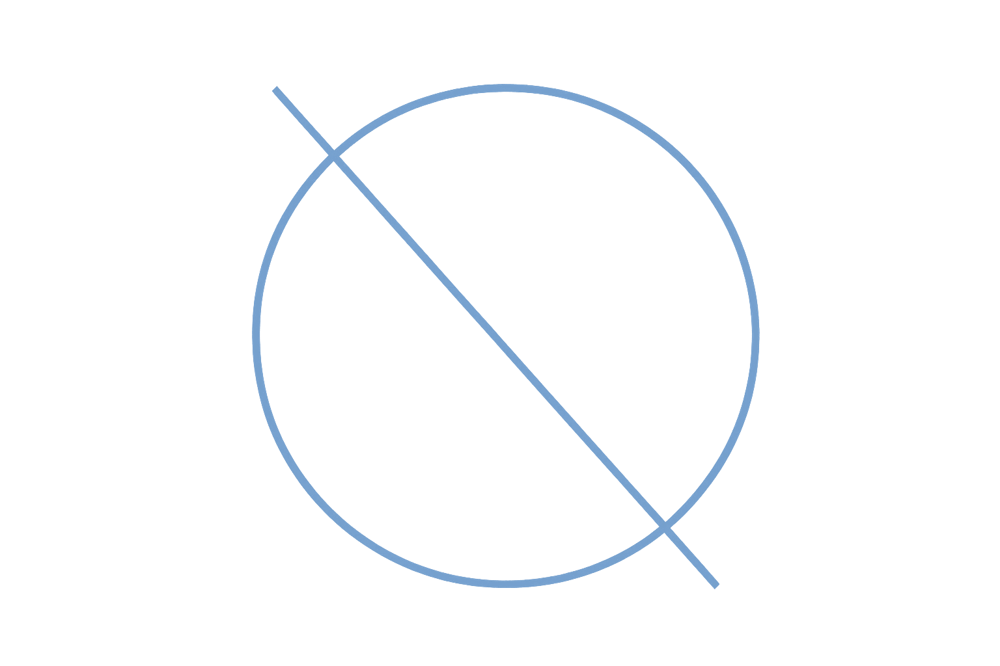

<p align="center">
  
</p>

<p align="center">
  
</p>

# Outpost

This is the **personal** branch for my own use with my personal dotfiles, packages, and NVIDIA support added. Also, a playground for trying BlueBuild features.
It publishes separately from production and won't be merged into `main` or `testing`.

### Packages
- docker-buildx
- docker-cli
- docker-compose
- eza
- fzf
- micro
- moby-engine
- ripgrep
- zoxide

## Install Reference

```bash
rpm-ostree rebase ostree-unverified-registry:ghcr.io/large-farva/outpost:latest
systemctl reboot
```

And then:

```bash
rpm-ostree rebase ostree-image-signed:docker://ghcr.io/large-farva/outpost:latest
systemctl reboot
```
